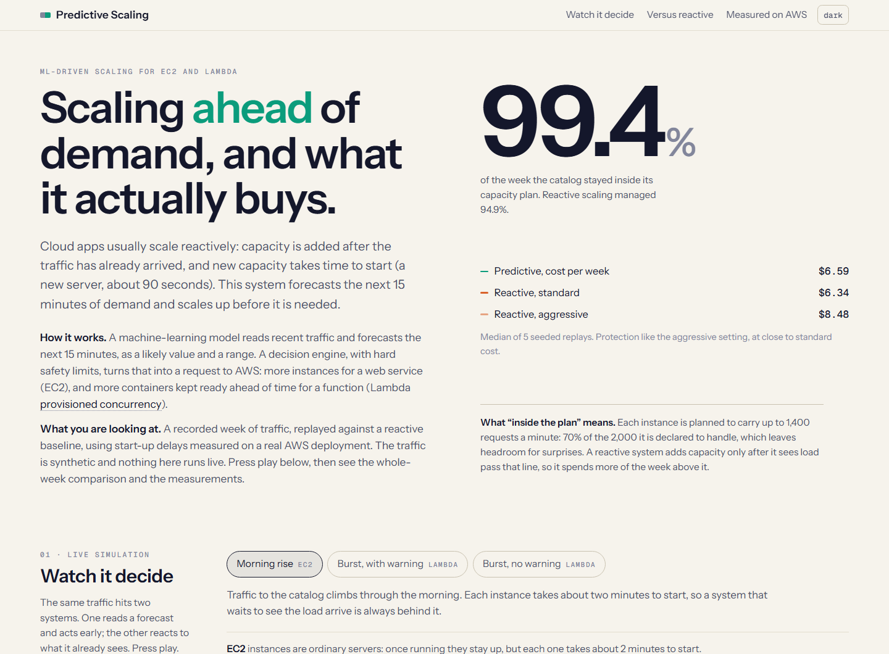
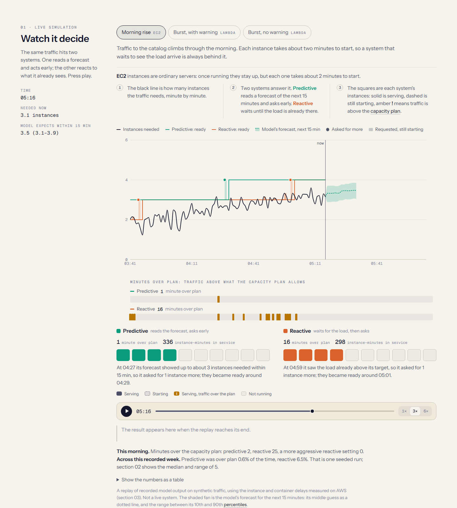
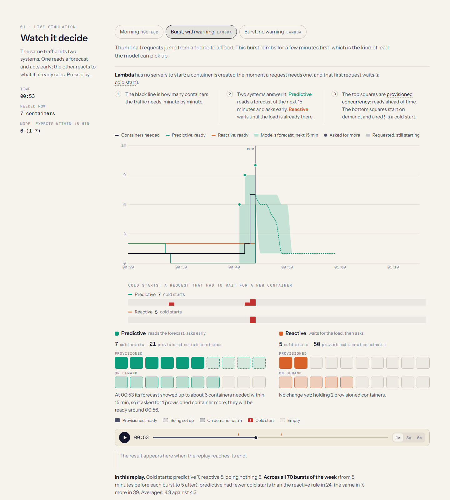
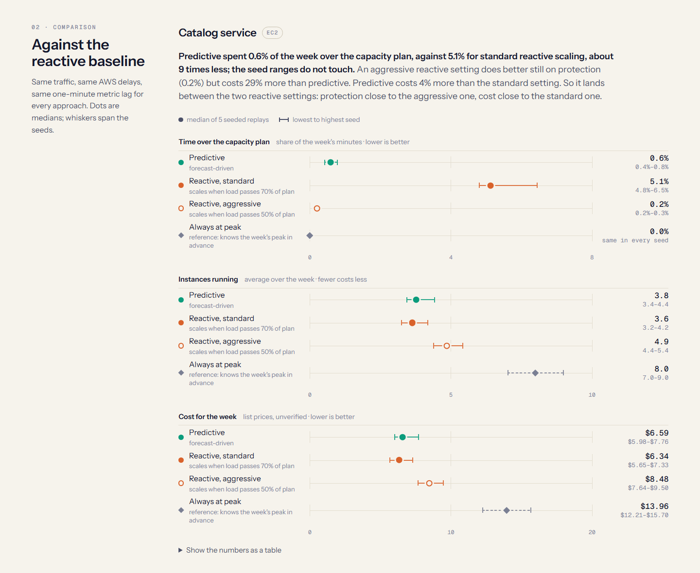
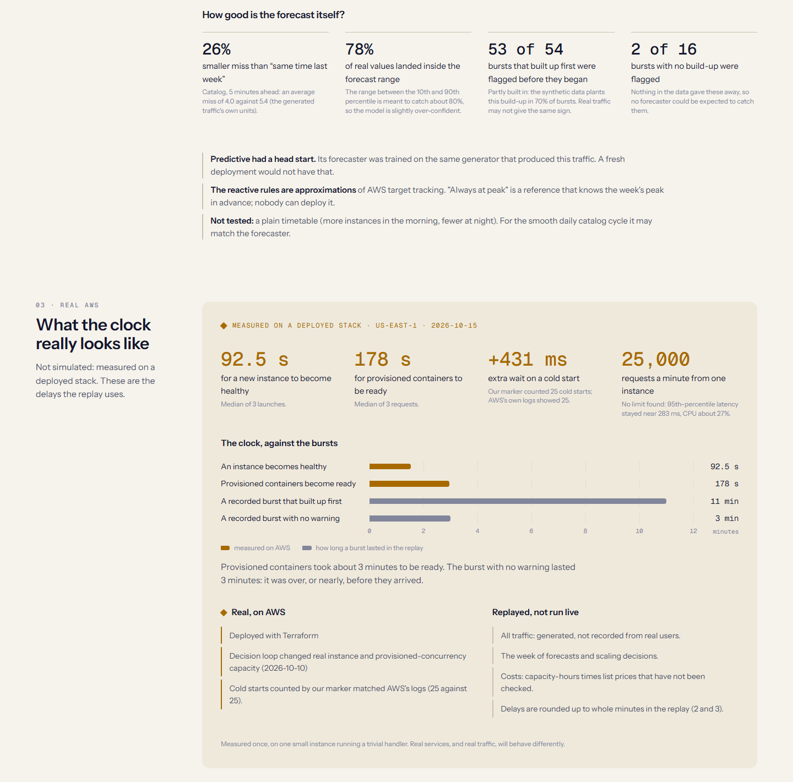

# Predictive Multi-Tier Scaling Engine

An ML-driven system that forecasts the next 15 minutes of traffic and **pre-scales two different AWS compute primitives before the load arrives**: an EC2 Auto Scaling Group for sustained load, and Lambda Provisioned Concurrency for bursty load. It is compared against reactive scaling in a replay, and the interactive dashboard in this repo lets you watch both systems handle the same traffic.



> **Read this first.** The comparison is a **replay on synthetic traffic**, using start-up delays **measured on a real AWS deployment**. Nothing in the dashboard runs live. What was real on AWS and what was replayed is listed [below](#what-is-real-and-what-is-replayed).

## Why

Reactive autoscaling adds capacity after the traffic has already arrived, and new capacity takes time to start: a new EC2 instance took about 90 s to become healthy, and a Lambda provisioned container about 3 minutes to become ready. A system that forecasts demand can ask for capacity early. This project builds that system and measures, honestly, when it helps.

## Results

Replay of one held-out week, median of 5 seeded runs. Full ranges are in the dashboard.

**Catalog service (EC2).** Predictive spends far less of the week over its capacity plan than standard reactive scaling, at a similar cost.

| Approach | Minutes over the 70% plan | Avg instances | Cost / week* |
|---|---|---|---|
| **Predictive** | **0.6%** | 3.8 | $6.59 |
| Reactive, standard (scales at 70%) | 5.1% | 3.6 | $6.34 |
| Reactive, aggressive (scales at 50%) | 0.2% | 4.9 | $8.48 |
| Always at peak (oracle reference) | 0.0% | 8.0 | $13.96 |

Aggressive reactive protects slightly better than predictive but costs about 29% more.

**Thumbnail service (Lambda).** **No clear difference.** Predictive averaged 4.3 cold starts per burst, a reactive provisioned-concurrency rule 4.0, doing nothing 5.0, and the seed ranges overlap. Across all 70 recorded bursts, predictive was better in 24, the same in 7 and worse in 39. This is largely what the delay predicts: provisioned containers take about 3 minutes to become ready, and bursts last only a few. Only holding capacity ready all week avoids cold starts (0.0 per burst), at 55% more cost. The result does not depend on the planted warning signal: with no burst giving advance notice, predictive scored 4.2.

**Forecast quality.** On the catalog series the forecaster's miss is 26% smaller than "same time last week" (5 minutes ahead), and its 10th-to-90th percentile range holds 78% of real values (aimed at 80%). It flagged 53 of 54 bursts that had a build-up before they began, and 2 of 16 that had none.

\*Costs are capacity-hours multiplied by AWS list prices that have **not been verified**; load-balancer and T3 burst-credit charges are excluded. Treat them as relative.

## What is real and what is replayed

| Real, on AWS | Replayed, not run live |
|---|---|
| Deployed with Terraform (ALB, ASG, Lambda, API Gateway) | All traffic: generated, not recorded from users |
| The decision loop changed a real ASG (1 → 2 instances) and real provisioned concurrency (0 → 1) on 2026-10-10 | The week of forecasts and scaling decisions |
| Instance became healthy in **92.5 s**; provisioned containers ready in **178 s** (medians of 3) | Reactive scaling is an approximation of AWS target tracking |
| Cold start costs **+431 ms**; our marker counted 25 cold starts and AWS's own logs showed 25 | Costs (unverified prices) |
| One t3.micro served **25,000 requests/min** with flat latency; no limit found (trivial handler) | Delays rounded up to whole minutes (2 and 3) |

An early measurement suggested a capacity limit of 3,200 requests/min per instance. A follow-up showed it was an artifact of the load client opening a new connection per request, not instance capacity, so catalog capacity in the comparison is a **declared** 2,000 requests/min per instance.

## How it works

```
 metrics ──► forecaster ──► decision engine ──► actuators ──► AWS
 (CloudWatch   p10/p50/p90,    policy, damping,     EC2 ASG desired capacity,
  or synthetic) 15 min ahead    hard caps            Lambda provisioned concurrency
                                      ▲
                          DRY_RUN + kill switch (fail closed)
```

- **Forecaster** (`forecasting/`): a gradient-boosted quantile model producing a value and a p10-p90 range, per service. Prophet was tried as a baseline and did not beat a seasonal-naive baseline; a deep model (TFT) was not built.
- **Decision engine** (`decision_engine/`): turns a forecast into a capacity request with hard caps, hysteresis and damping so it does not flap.
- **Actuators**: `set_desired_capacity` on the ASG and `put_provisioned_concurrency_config` on a Lambda alias.
- **Replay comparison** (`comparison/`): runs every policy over the same traffic, delays and one-minute metric lag, and writes the results the dashboard shows.

## Safety

This project can spend money and change real infrastructure, so safety is enforced in code and tested without touching AWS (`moto`):

- **Hard caps** (EC2 10 instances, Lambda 10 containers) enforced in the policy and again in each actuator. Out-of-range requests are refused, never silently clamped.
- **Dry run by default.** Only the literal `DRY_RUN=false` allows real actuation.
- **Kill switch** in SSM Parameter Store, read before every cycle. It fails closed: anything other than `RELEASED`, including an error, blocks actuation. `make kill` engages it.
- **Least-privilege IAM** for a scoped user, a **$10 monthly budget alarm**, and `make destroy`, which tears the stack down and then verifies nothing billable is left.

## Run it

Requires Python 3.11 and Node 18+.

```bash
python -m venv .venv && source .venv/bin/activate      # Windows: .venv\Scripts\activate
pip install -r requirements.txt
make test            # ~800 tests; no AWS account or database needed (takes a few minutes)
```

**The dashboard** needs generated data, which is not committed. This takes a few minutes and needs no AWS or database:

```bash
python -m comparison.replay_compare --seeds 42 1 2 3 4 --out replay_output/comparison_5seeds.json   # ~5 min
python -m scripts.export_dashboard_data                                                              # ~1 min
cd dashboard && npm install && npm run dev
```

`npm run build` makes a static site in `dashboard/dist`. Run the two Python commands first in any build or deploy step.

**Real AWS** is optional and costs money. Deploy with `terraform apply` in `infra/` (see [`infra/README.md`](infra/README.md) for the one-time bootstrap), keep the kill switch engaged unless you mean to scale, and tear down with `make destroy`. The decision loop runs with `python -m scheduler.loop_handler`, driven by replayed history rather than live traffic, and as a dry run unless told otherwise. The metrics and training pipeline uses a local TimescaleDB (`docker compose up -d`, copy `.env.example` to `.env`).

**Load generation** (Locust): `locust -f load_generator/catalog_locustfile.py --headless --host http://localhost:8000` against a local `uvicorn demo_app.catalog_service.main:app`, or `locust -f load_generator/thumbnail_locustfile.py --headless --host <api_invoke_url>` against a deployed stack. Shapes are tuned by env vars in `load_generator/shapes.py`.

## Repository layout

```
demo_app/        catalog_service (FastAPI on EC2) and thumbnail_service (Lambda)
load_generator/  Locust load shapes and scenario replay
forecasting/     data pipeline, synthetic data, baselines, quantile model
decision_engine/ policy, damping, actuators, kill switch
scheduler/       the predict -> decide -> actuate loop and decision grading
comparison/      replay comparison, cost model, AWS calibration, dashboard export
dashboard/       React + Recharts replay dashboard
infra/           Terraform (infra/bootstrap holds state backend, IAM and budget)
tests/           unit tests (moto for AWS)
```

## Limitations

- Synthetic traffic: the forecaster was trained on the same generator that produced the test traffic, a head start a new deployment would not have. A share of bursts has a planted build-up, which flatters burst detection.
- One scenario family and 5 seeds. Catalog latency was not stressed, so the EC2 result is provisioning accuracy and cost, not user-visible speed.
- A plain timetable (more instances by day, fewer at night) was **not tested**; for the smooth daily catalog cycle it may match the forecaster.
- Lambda: no clear benefit in this replay. Pre-warming containers by invoking them early, rather than using provisioned concurrency, was not tried.
- One Locust-driven test (`test_real_locust_records_failures`) is occasionally flaky.

## Screenshots

| | |
|---|---|
|  |  |
|  |  |
